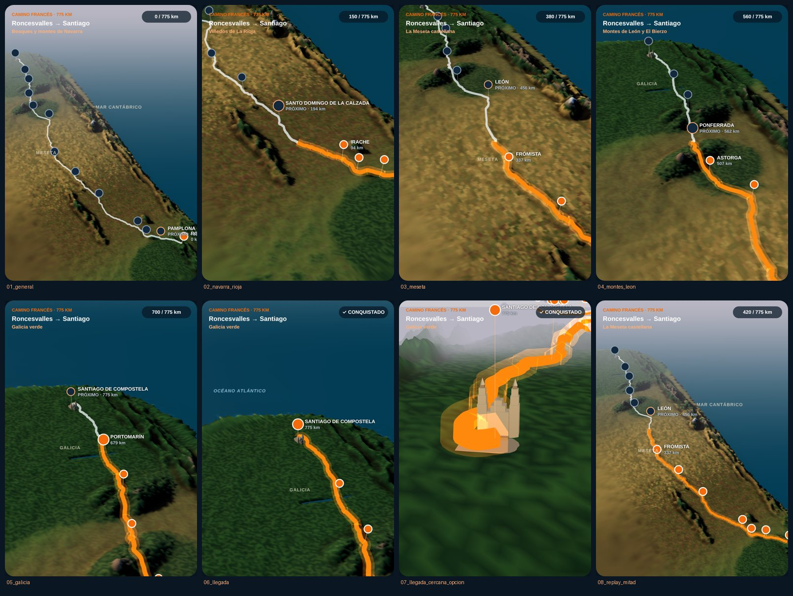

# Mapa 3D — Camino de Santiago (775 km)

Propuesta de diseño y prototipo técnico. Rama `mapa3d/camino-santiago-20261105`,
creada desde `1a0658f` (`modo-libre-korva-20261004`). **No está activado:** la
escena no está en `CONFIGS` ni en el registro `escenas/index.js`, no hay UUID y
no se tocó Supabase, Shopify ni progreso de usuarios.

## 1. Qué se reutiliza y qué es nuevo

Se reutiliza el motor de Fin del Mundo y Monte Fuji: `terrenoCore` genera el
relieve offline, `hornearMapa3D.js` lo hornea y `MapaRecorrido3D` lo muestra.
Cámara, gestos, replay, seguimiento, selección y scroll son los de
`docs/mapas-3d-base.md`; **no se cambió ningún valor de `ajustesInteraccion.js`
ni del componente**.

| Pieza | Archivo | Afecta a otros mapas |
| --- | --- | --- |
| Escena (sólo datos) | `services/mapa3d/escenas/caminoSantiago.js` | No |
| Trazado verificado | `services/mapa3d/escenas/caminoSantiago.trazado.js` | No |
| Horneado | `services/mapa3d/escenas/caminoSantiago.horneado.js` (631 KB) | No |
| Regiones de paisaje (`biomas`) | `terrenoCore.js`, opcional | No: sólo si la escena define `biomas`. Fin del Mundo, Fuji y Dubrovnik se re-hornean byte a byte iguales |
| Monumento de llegada | `components/mapa3d/monumentoLlegada.js` + 2 líneas en `construirMundo.js` | No: sólo si la escena define `monumentoLlegada` |
| Pruebas | `tests/mapa3dCaminoSantiago.test.js` | — |
| Herramientas (fuera de la app) | `tools/mapa3d/` | — |

Antes de activar sólo falta (ver §8): registrar la escena, crear su `CONFIGS`
con textos y el UUID real.

## 2. Tres capas separadas

1. **Geografía real** — el trazado y las coordenadas de localidades y pasos.
2. **Kilómetros virtuales** — los 775 km del desafío. Se fijan con 13 anclas
   sobre el trazado (`HITOS_KM` en la escena); entre dos anclas el avance es
   proporcional a la distancia geográfica. Cambiar un km virtual mueve el
   progreso sin tocar la geografía.
3. **Representación artística** — relieve, colores por región, exageración
   vertical ×9, mares y el monumento de llegada. No es un modelo de elevación.

## 3. Trazado

**Fuente base:** traza del Camino Francés de caminofrances.info (B. Guptill la
retrazó a mano a partir de su GPS y P. Rukavina la exportó a GeoJSON; copia
publicada en `vaadin/docs` como `camino-frances-route.geojson`, 2.028 puntos). Su licencia de datos no está
declarada: antes de publicar conviene confirmarla o reemplazarla por la relación
OSM del Camino Francés (ODbL). El generador acepta cualquier GeoJSON LineString.

Proceso (`tools/mapa3d/trazado_camino_santiago.py`):

1. Recorte en Roncesvalles (la traza empieza en Saint-Jean-Pied-de-Port).
2. **León → Hospital de Órbigo por Villadangos del Páramo y San Martín del
   Camino** (N-120). La traza base iba por Villar de Mazarife.
3. **Sahagún → Mansilla por el Real Camino** (Bercianos, El Burgo Ranero,
   Reliegos). La traza base iba por la Calzada de los Hermanillos.
4. **San Xil**: la traza base ya iba por San Xil, no por Samos (verificado:
   Samos queda a más de 4 km).
5. Final en la Praza do Obradoiro (42,8806, −8,5458).
6. Simplificación Douglas-Peucker con tolerancia de 60 m → 1.035 puntos.

Las 13 paradas y 45 localidades de control se comprobaron contra Wikipedia,
GeoNames y guías del Camino; ninguna queda a más de 1 km del trazado:

| Localidad | Fuente | Distancia al trazado |
|---|---|---:|
| Roncesvalles | Wikipedia | 0,0 km |
| Pamplona | GeoNames | 0,0 km |
| Puente la Reina | GeoNames | 0,0 km |
| Estella | GeoNames | 0,36 km |
| Monasterio de Irache | Wikipedia | 0,0 km |
| Los Arcos | GeoNames | 0,03 km |
| Torres del Río | GeoNames | 0,01 km |
| Viana | GeoNames | 0,05 km |
| Logroño | GeoNames | 0,01 km |
| Navarrete | GeoNames | 0,01 km |
| Nájera | GeoNames | 0,06 km |
| Santo Domingo de la Calzada | GeoNames | 0,0 km |
| Belorado | GeoNames | 0,03 km |
| Atapuerca | GeoNames | 0,04 km |
| Burgos | GeoNames | 0,73 km |
| Tardajos | GeoNames | 0,04 km |
| Hornillos del Camino | GeoNames | 0,0 km |
| Hontanas | GeoNames | 0,03 km |
| Itero de la Vega | GeoNames | 0,12 km |
| Boadilla del Camino | GeoNames | 0,1 km |
| Frómista | GeoNames | 0,0 km |
| Villalcázar de Sirga | GeoNames | 0,0 km |
| Carrión de los Condes | GeoNames | 0,32 km |
| Sahagún | GeoNames | 0,0 km |
| Bercianos del Real Camino | Wikipedia | 0,0 km |
| El Burgo Ranero | Wikipedia | 0,0 km |
| Reliegos | GeoNames | 0,02 km |
| Mansilla de las Mulas | GeoNames | 0,0 km |
| León | GeoNames | 0,0 km |
| Villadangos del Páramo | GeoNames | 0,0 km |
| San Martín del Camino | GeoNames | 0,0 km |
| Hospital de Órbigo | GeoNames | 0,0 km |
| Astorga | GeoNames | 0,0 km |
| Molinaseca | GeoNames | 0,03 km |
| Ponferrada | GeoNames | 0,0 km |
| Cacabelos | GeoNames | 0,04 km |
| Villafranca del Bierzo | GeoNames | 0,03 km |
| Trabadelo | GeoNames | 0,02 km |
| O Cebreiro | mejoresrutas | 0,0 km |
| San Xil | GeoNames | 0,11 km |
| Sarria | GeoNames | 0,44 km |
| Portomarín | GeoNames | 0,0 km |
| Melide | GeoNames | 0,04 km |
| Arzúa | GeoNames | 0,32 km |
| Santiago (Obradoiro) | Wikipedia | 0,0 km |

Burgos queda a 0,73 km porque GeoNames da un punto del centro urbano que no
cae sobre la calle del Camino; ahí el ancla es el vértice más cercano del
trazado (no se mueve el trazado hacia el centroide).

**Distancias:** la traza simplificada mide 723,5 km entre Roncesvalles y el
Obradoiro; el Camino caminado ronda 760-790 km según la guía. Los 775 km
virtuales se reparten con un factor casi constante (~1,07) entre todas las
anclas, así que los km provisorios ya están alineados con el trazado visual.

**Única desviación artística:** en los últimos ~11 km el trazado rodea el flanco
norte del monumento (como el Camino real por la Azabachería) y entra a la plaza,
porque la catedral se dibuja en escala simbólica (§5).

## 4. Diseño visual

- **Encuadre general:** cámara desde el sureste (azimut 122°, elevación 46°).
  El camino cruza la pantalla en diagonal: Roncesvalles abajo a la derecha,
  Santiago arriba a la izquierda. Usa el alto del teléfono sin el
  escorzo extremo de mirarlo de frente.
- **Cinco capítulos de paisaje** (mismo mecanismo que Islandia): la cabecera
  dice la región y sólo se rotulan el seleccionado, el próximo, el último
  conquistado y el inicio, para que 13 paradas no se pisen.
  1. *Bosques y montes de Navarra* (0-94): verde, Pirineos, Perdón, Montejurra.
  2. *Viñedos de La Rioja* (94-230): mosaico de parcelas granate y verde.
  3. *La Meseta castellana* (230-507): mosaico de cereal ocre y dorado, llano.
  4. *Montes de León y El Bierzo* (507-615): Cruz de Ferro 1.500 m, valle del Bierzo.
  5. *Galicia verde* (615-775): O Cebreiro 1.300 m, prados, Miño, Atlántico.
- **Horizonte:** Cordillera Cantábrica y Picos de Europa al norte, mar
  Cantábrico detrás, Atlántico al oeste. Luz baja del oeste-suroeste: se camina
  hacia el atardecer.
- **Identidad Korva:** línea naranja, pines y HUD de siempre; paleta de cielo navy.
- **Llegada:** fachada del Obradoiro (dos torres, cuerpo central, plaza)
  mirando al oeste, en escala simbólica.

## 5. Escala y llegada: la decisión pendiente

Con 775 km en pantalla, 1 píxel ≈ 1 km: una catedral real de ~100 m no se
puede ver. Opciones:

- **A — Monumento simbólico (implementado en el prototipo).** La fachada mide
  7 km "de mapa": se reconoce al acercar (zoom 0,5, vista 06) y en la vista
  general es un punto junto al pin final. Cero cambios de cámara o gestos.
- **B — Cámara de llegada cercana (no implementado, vista 07).** Permitir
  acercar mucho más sólo en esta escena. Requiere cambiar el límite de zoom
  (hoy 0,5-1,7) y escalar el grosor de la línea con el zoom: a esa distancia
  la ruta actual se ve como una franja enorme sobre la plaza (ver captura).
  Toca la base de interacción y necesita prueba en teléfono.
- **C — Postal de cierre.** Mantener A y, al completar, mostrar en el cartel
  "RECORRIDO COMPLETADO" una ilustración 2D del Obradoiro. No toca el 3D.

Recomendación: **A + C**. B sólo si se acepta una prueba aparte de la base de
interacción.

## 6. Legibilidad y rendimiento

| Medida | Camino | Referencia |
| --- | --- | --- |
| Malla de terreno | 452 × 170 = 76.840 vértices | Fin del Mundo 316 × 240 = 75.840 |
| Horneado | 631 KB | Fin del Mundo 605 KB, Dubrovnik 549 KB |
| Resolución en la ruta | 1,6 km | Fin del Mundo 0,42 km |
| Draw calls de escena | 5 (cielo, terreno, mar, Miño, monumento) + hasta 3 de ruta | Fin del Mundo + 1 (el monumento) |
| Monumento | ~250 triángulos, sin texturas | — |
| Ruta | 1.015 puntos de control, muestreo cada 0,8 km | tubo limitado a 700 segmentos |

- El horneado en Node tarda ~1,4 s; el teléfono sólo decodifica (como los demás).
- La línea procedural se reconstruye cada 120 ms durante el replay (base
  común); con 910 muestras queda dentro del límite de 700 segmentos del tubo.
- Replay: 25 s (base común). Para 775 km quizá convenga una curva por distancia
  como Islandia (`duracionReplay`); queda como decisión, no se cambió.
- Seguimiento del replay: peso 0,2 (Islandia usa 0,18): con 0,45 la cámara
  barrería 600 km y marearía.
- Las mediciones del banco web son en escritorio con render por software:
  **no son FPS de teléfono**. Falta la prueba en iPhone (§8).

## 7. Cómo se verificó

- `node --test tests/mapa3dCaminoSantiago.test.js`: 8 pruebas — horneado
  sincronizado; 0→775 km monótono; cada hito en su km y a <1 km de su
  coordenada; pasa por San Martín del Camino, Villadangos, San Xil, Bercianos y
  El Burgo Ranero y no por Samos; 12 localidades intermedias sobre el trazado;
  Cruz de Ferro >1.300 m, O Cebreiro >1.150 m, Meseta llana, Santiago <400 m;
  la ruta nunca bajo el agua; malla dentro del presupuesto; escena no activada.
- `npm test` completo: 163 pruebas, 156 pasan. Las 7 que fallan fallan igual en
  `1a0658f` sin estos cambios (horneados de San Andrés e Islandia, gestos y
  agua de horneados antiguos): son previas.
- Re-horneado de Fin del Mundo, Monte Fuji y Dubrovnik con el motor nuevo:
  idénticos byte a byte.
- Banco web (`tools/mapa3d/banco`): monta el `construirMundo` real en Chrome
  headless y genera las vistas de la imagen de arriba.

## 8. Pendiente

1. Decidir la llegada (§5) y validar el encuadre en iPhone.
2. Confirmar la licencia de la traza base o regenerar desde OSM.
3. Textos de las 13 paradas, UUID y producto (otro chat) → recién entonces:
   `CONFIGS.camino_santiago` en `MapaRecorrido.js`, una línea en
   `escenas/index.js` y el mapeo por UUID en `getConfig`.
4. Ajustes finos de relieve tras verlo en teléfono (Montes de León y Ancares se
   ven como domos; la Cordillera Cantábrica algo lineal).
5. Prueba en teléfono según `docs/mapas-3d-base.md`: replay completo, rotado,
   zoom durante replay, detener, elegir hito y scroll.
